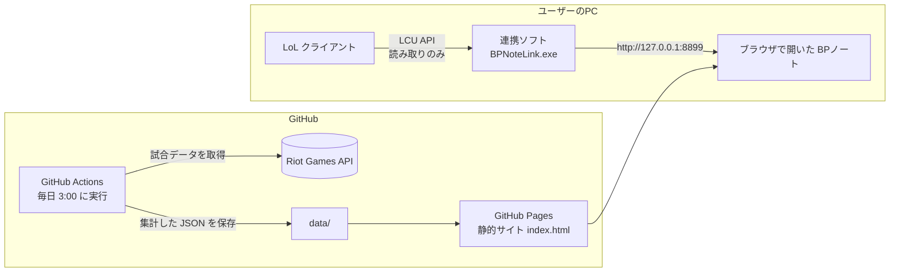

# BPノート

**League of Legends の「バン・ピック（BP）」で迷う初心者のための、判断支援ツールです。**
チャンプ選択の画面で見えている味方・敵のピックを入れると、「今のチームに何が足りないか」「誰を出せばいいか」を、理由つきの日本語で返します。

- サイト：https://blackpanda0609.github.io/lol-sup-ban-pick/
- 対象：JP・KR サーバーのエメラルド以上のソロランク（毎日自動で集計）
- 連携ソフト（Windows）：[Releases](https://github.com/blackpanda0609/lol-sup-ban-pick/releases/latest) から入手

<!-- スクリーンショットを docs/screenshot.png に置くとここに表示されます -->
<!--  -->

---

## なぜ作ったのか

LoL では、試合前の約30秒のチャンプ選択で、勝敗が大きく左右されます。ところが初心者には、
「味方の構成で何が足りないのか」「相手に対して何を出せばいいのか」を、その短い時間で判断する知識がありません。

既存の統計サイトは、勝率やビルドの「数字」を大量に見せてくれます。しかし、初心者にとっては情報が多すぎて、**数字から判断を組み立てること自体が難しい** のが実情です。
私自身がサポートをプレイするなかで感じたこの問題を解決するために、**BPの判断だけに絞った道具** として作りました。

## 他のツールとの違い

| | OP.GG・Blitz などの統計サイト | BPノート |
|---|---|---|
| 目的 | 勝率・ビルド・戦績などの統計を網羅的に見せる | **BPの判断を、迷わず短時間で決める** |
| 想定ユーザー | ある程度ゲームを理解しているプレイヤー | **何を考えればいいかわからない初心者** |
| 情報の出し方 | 数字の一覧（解釈は利用者に任せる） | **「足りないもの → おすすめ → 理由」の順に、日本語で提示** |
| チーム構成 | 個々のチャンプの成績が中心 | **味方の構成の穴（AD/APの偏り、前衛・CC・エンゲージの有無）を自動で判定** |
| 集計方法 | 非公開 | **補正の方法まで公開**（後述） |

数字の量や網羅性では大手サイトに及びません。そのぶん、**「BP中に何を考えればいいか」を順番どおりに案内すること** に価値を置いています。

## 画面と使い方：4つのステップ

ゲームのチャンプ選択と同じ順番で、上から埋めていく作りにしています。

1. **相手と味方を見る**
   味方5人・敵5人の枠にピックを入れます（連携ソフトを使えば自動で入ります）。
   味方の構成から「AD/APの割合」「DPS・フロント・CC・エンゲージの人数」を判定し、**足りないものを自動で選びます**。
2. **ピックを決める**
   足りないものを補えて、対面に強く、隣の味方（ADC⇔サポート）と相性がいいチャンプを、点数順に提案します。
   各候補には「レル相手に58.7%（109試合）」「★ランタンで救出、フレイで守る」のような **理由** を添えます。
3. **ルーンとサモナースペル**
   決めたチャンプで、そのロールに多いルーンのページを、ゲームのルーン画面と同じ配置で表示します。
4. **ゲーム開始後**（折りたたみ）
   スタートアイテム・スキルの上げ順など。BPの判断には使わないため、普段は隠しています。

そのほか、各ロールの **Tier（環境での強さ）一覧**、チャンプ名から詳細へ飛べる共有用URL（例：`#sup-thresh`）、スマホ表示に対応しています。

## システム構成



- **サーバーを持たない構成**：データ収集は GitHub Actions の定期実行、配信は GitHub Pages の静的サイトのみ。運用コストは0円です。
- **APIキーの管理**：Riot API のキーは GitHub Actions の Secrets に置き、サイト側には一切出しません。
- **連携ソフト**：LoL クライアントが PC 内だけで公開している API（LCU）からチャンプ選択の内容を読み取り、`127.0.0.1` だけで待ち受けてサイトに渡します。外部への送信や、ゲームの操作は行いません。

## 使っている技術

| 分野 | 技術 |
|---|---|
| フロントエンド | HTML / CSS / JavaScript（フレームワークなし、1ファイル） |
| データ収集 | Python 3（標準ライブラリのみ） |
| 自動実行・配信 | GitHub Actions（cron）、GitHub Pages |
| 外部データ | Riot Games API（League-V4, Match-V5, タイムライン）、Data Dragon（画像・名称） |
| 連携ソフト | Python + LCU API、PyInstaller で exe 化 |

## データ処理で工夫したこと

統計を「それらしく見せる」のではなく、**偏りのない数字を出すこと** を重視しました。

- **サンプルの選び方による偏りを除去**
  「今エメラルド以上にいるプレイヤー」の最近の試合を集めると、その人は勝ち越して今のランクにいるため、勝ちに偏ります。
  そこで、試合を見つけるきっかけになったプレイヤーのレーンは集計から外し、選び方と無関係な残り8人だけを数えています。
- **少ない試合数のぶれを補正**
  5戦5勝のようなデータが上位に来ないよう、勝率に「20勝20敗」を足してならした値で順位を付けています（ベイズ的な縮小推定）。
  勝率をタップすると、ウィルソン法による95%信頼区間（例：43.9%〜62.3%）も確認できます。
- **環境への影響力で Tier を算出**
  勝率だけでなく、ピック率・BAN率も加味した独自のスコアで Tier を決めています。BAN率はチャンプ単位の値なので、そのロールで使われている割合で按分し、「MIDで多くBANされるチャンプのSUP」が不当に上がらないようにしました。
- **役割の判定に実データを使う**
  AD/AP はダメージの「割合」ではなく「1分あたりの量」で判定しています（割合だと、ダメージの少ないタンクも AP と判定されてしまうため）。
- **API の利用制限を守る**
  無料キーの制限（2分あたり100回）を超えないよう、送信間隔を自前で制御し、429 応答時は待機してから再試行します。

## 開発で苦労したこと・学んだこと

- **使う人の行動から画面を設計し直したこと**：最初は機能を並べた画面でしたが、実際にランク戦で使ってみて「ピック中は30秒しかない」「ほしい情報の順番がある」と気づき、ゲームの流れに沿った4ステップに作り直しました。
- **統計の落とし穴**：OP.GG と勝率が食い違ったことをきっかけに原因を調べ、試合数の少なさとサンプリングの偏りの2つが原因だと突き止めて、集計方法を修正しました。
- **スマホでの操作感**：プルダウンを開くとキーボードが出てしまう、表がスクロールで見づらい、などを実機で確認しながら改善しました。
- **データの重複**：ルーンの選択順だけが違う同じページが別物として数えられていた問題を見つけ、正規化して集計するようにしました。

## ディレクトリ構成

```
.
├── index.html                    # サイト本体（GitHub Pages で配信）
├── collector/collect.py          # 試合データの収集・集計
├── .github/workflows/collect.yml # 毎日の自動実行の設定
├── data/
│   ├── index.json                # パッチごとの試合数
│   ├── patches/{パッチ}.json     # 勝率・対面・組み合わせなどの集計
│   └── builds/{パッチ}.json      # ルーン・アイテム・スキル順の集計
└── tools/lcu_bridge.py           # 連携ソフトのソースコード（exe は Releases で配布）
```

## 自分で動かす場合

1. Riot Developer Portal で API キー（Personal API Key）を取得する
2. リポジトリの **Settings → Secrets and variables → Actions** に `RIOT_API_KEY` として登録する
3. **Actions → Collect match data → Run workflow** で収集を実行する（以後は毎日自動）
4. **Settings → Pages** で GitHub Pages を有効にする

## 開発の進め方

課題の設定、画面の設計、機能の優先順位、統計上の判断（何を指標にし、何を表示しないか）は、すべて私が実際のプレイ経験をもとに決めました。
実装は AI（Claude）とのペアプログラミングで進め、提案されたコードを動かして確かめ、実際のランク戦で使いながら改善を重ねています。

## 今後の予定

- 自分のチャンププール（使えるチャンプ）を登録し、その中からだけ提案する
- 自分のプールと今の環境から、BAN候補を提案する
- 敵の構成（AP寄り・エンゲージが多いなど）も、おすすめの点数に反映する

---

BPノートは Riot Games の承認を受けたものではなく、Riot Games やその関係者の見解・意見を反映するものではありません。League of Legends および Riot Games は Riot Games, Inc. の商標または登録商標です。League of Legends © Riot Games, Inc.
